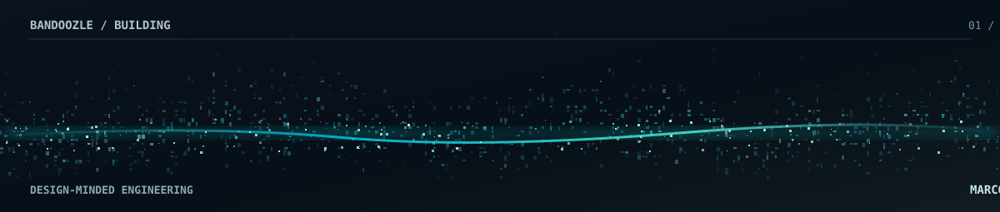
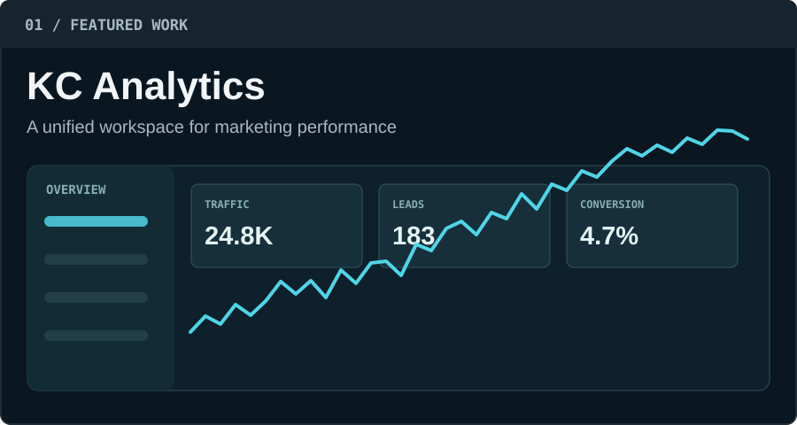
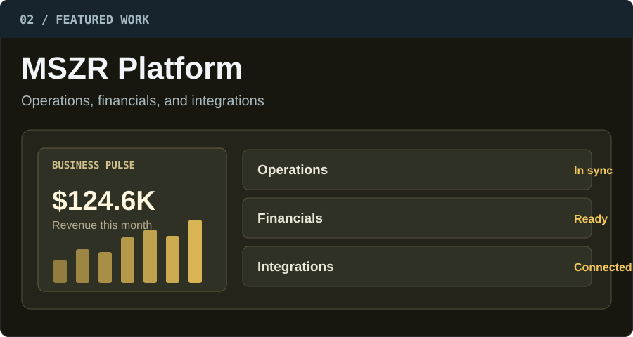

<!-- Profile README: place this README.md in the Bandoozle/Bandoozle repository. -->

  

<table width="100%">
  <tr>
    <td width="62%" valign="top">
      <h1>Hey, I'm Marco 👋</h1>
      
Full-stack software developer who cares about how things work <i>and</i> how they feel.

      
I build web products, useful tools, and thoughtful interfaces, from backend systems to the small details that make a product enjoyable.

      
<code>NOW</code> &nbsp; Building product experiences at Kosick 
      <code>BASED</code> &nbsp; Vancouver, Canada 
      <code>ALSO</code> &nbsp; AI/ML, football, and good UI

    </td>
    <td width="38%" valign="top">
      <table width="100%">
        <tr><td>ROLE <b>Full-stack developer</b></td><td>FOCUS <b>Web products</b></td></tr>
        <tr><td>STATUS <b>Building</b></td><td>APPROACH <b>Design + code</b></td></tr>
      </table>
    </td>
  </tr>
</table>

<h3>Selected work  / things I've built</h3>

<table width="100%">
  <tr>
    <td width="50%" valign="top">
      
      <h3>KC Analytics</h3>
      
A marketing analytics workspace bringing reporting, performance insights, and integrations into one place.

      Next.js · TypeScript · Supabase · APIs
    </td>
    <td width="50%" valign="top">
      
      <h3>MSZR Platform</h3>
      
A platform for dealer operations, goal tracking, financial visibility, and connected services.

      React · TypeScript · Supabase · Integrations
    </td>
  </tr>
</table>

<h3>My toolkit</h3>

<table width="100%">
  <tr><td width="23%"><code>LANGUAGES</code></td><td>TypeScript · JavaScript · Python · C++</td></tr>
  <tr><td><code>FRONTEND</code></td><td>React · Next.js · Tailwind CSS</td></tr>
  <tr><td><code>BACKEND</code></td><td>Node.js · FastAPI · PostgreSQL · Supabase · Firebase</td></tr>
  <tr><td><code>TOOLS</code></td><td>Git · Docker · Vercel</td></tr>
</table>

  <a href="https://marcosuteja.com">Portfolio</a> &nbsp;·&nbsp;
  <a href="https://github.com/bandoozle">GitHub</a> &nbsp;·&nbsp;
  <a href="https://www.linkedin.com/in/marcosuteja">LinkedIn</a>
  
Always building something.

